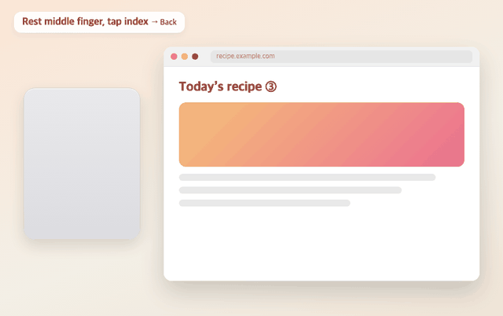

<p align="center"></p>

# ✌️ TokTok — trackpad gestures, and nothing else

**English** · [한국어](README.ko.md)

**Rest a finger on your Mac trackpad and tap beside it to go back.** Tap a corner to snap a window, slide along an edge for volume, rest three fingers for a radial menu. A small menu-bar app that does **only the trackpad**: just check a box and pick an action.

- 🌐 **Website with animated demos:** https://apps.seoriarts.com/toktok/en
- ⬇️ **Download (notarized):** [latest release](https://github.com/hanseolhui/toktok/releases/latest) · `brew install --cask hanseolhui/tap/toktok`
- 🧩 **Open-source engine:** [**TrackpadKit**](https://github.com/hanseolhui/TrackpadKit), the Swift package TokTok is built on (raw touches · palm rejection · gesture recognition, MIT)

## Why

Most people who customize their trackpad do it inside a big all-in-one tool. TokTok is the opposite bet: one job, done carefully, staying out of your way.

| | |
|---|---|
| App size | 7.2 MB (2.1 MB download) |
| Memory | ~17 MB |
| CPU while idle | 0% |
| Settings | one checkbox + one dropdown per gesture, each with an animated demo |
| Languages | English · 日本語 · 简体中文 · 한국어 |

*Measured on an Apple silicon MacBook with TokTok 1.5.4.*

## Gestures

| Gesture | How (right hand) | Default |
|---|---|---|
| Rest & tap left / right | rest your middle finger, tap with your index (or the other way round) | Back ⌘[ / Forward ⌘] |
| Two fingers rest + tap | rest two fingers, tap left / right / between | previous tab / next tab / reload |
| Three-finger tap · press | tap with three fingers · press the pad down with three fingers | middle click (open link in new tab) · middle click & drag |
| Corner taps | tap a corner or the top center | snap left / right / fill; **tap again to cycle ½ → ⅓ → ⅔** |
| Edge sliders | slide along any edge | volume · brightness, one haptic tick per step |
| ⭐ Radial menu | rest three fingers, then slide | 8 slots of apps, folders, shortcuts; per-app sets and submenus |
| ⭐ Undo dial | rest two fingers, slide a third left / right | ⌘Z / ⇧⌘Z one step at a time |
| ⭐ Double taps | double-tap corners or with 3–4 fingers | quarters, next display, screenshot to clipboard |
| ⭐ Title-bar gestures | two-finger swipe / pinch on a window's title bar | snap, fill, center, minimize, full screen |
| ⭐ Input language per app | — | each app gets back the keyboard language you last used in it |

Every gesture can trigger any of 50+ built-in actions; Pro adds your own shortcuts (including key sequences), opening apps and running Shortcuts, per-app actions, and settings sync across your Macs.

What took the most care: **palms resting on the pad while you type don't trigger gestures**, and **tap-to-click doesn't fire in the middle of a gesture**.

## Price

Free to use. **The first 7 days include everything in Pro.** After that, Pro is a **one-time $7.99 for up to 3 Macs** — no subscription. [Get Pro](https://apps.seoriarts.com/toktok/en#buy)

## Install

macOS 13+, Apple silicon and Intel, notarized by Apple.

```bash
brew install --cask hanseolhui/tap/toktok
```

or download `TokTok.zip` from the [latest release](https://github.com/hanseolhui/toktok/releases/latest) and move `TokTok.app` to Applications. On first launch, allow **System Settings → Privacy & Security → Accessibility → TokTok** (needed to send keys and move windows).

## Honest notes

- Finger positions come from Apple's private `MultitouchSupport` framework, like every trackpad tool. A future macOS could break something; fixes ship fast and updates are one click.
- Gesture recognition runs entirely on your Mac. TokTok never reads what you type or what's on screen. An anonymous daily ping (random install ID, app version, language, macOS version, Mac model, Pro on/off) can be turned off in Settings → General.

## Feedback

Settings → Help → **Send feedback** goes straight to the developer, or open an [issue](https://github.com/hanseolhui/toktok/issues). If TokTok makes your trackpad nicer to use, a ⭐ helps other people find it.

## License

The gesture engine is open source as [TrackpadKit](https://github.com/hanseolhui/TrackpadKit) (MIT); `Sources/` (TokTokCore) and `install.sh` in this repository are MIT too. The TokTok app is free to use; Pro features are closed source and require a license.
